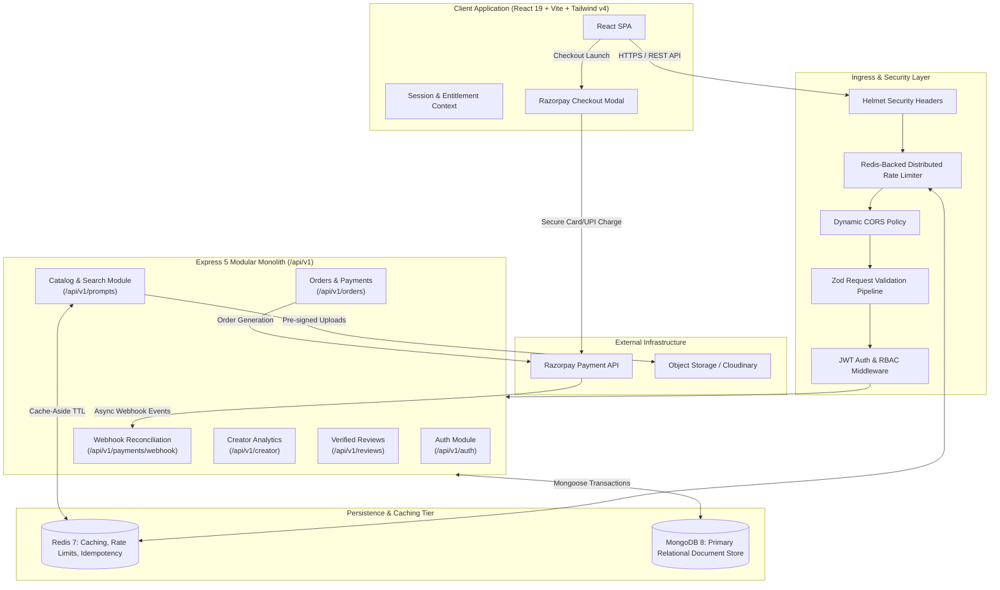
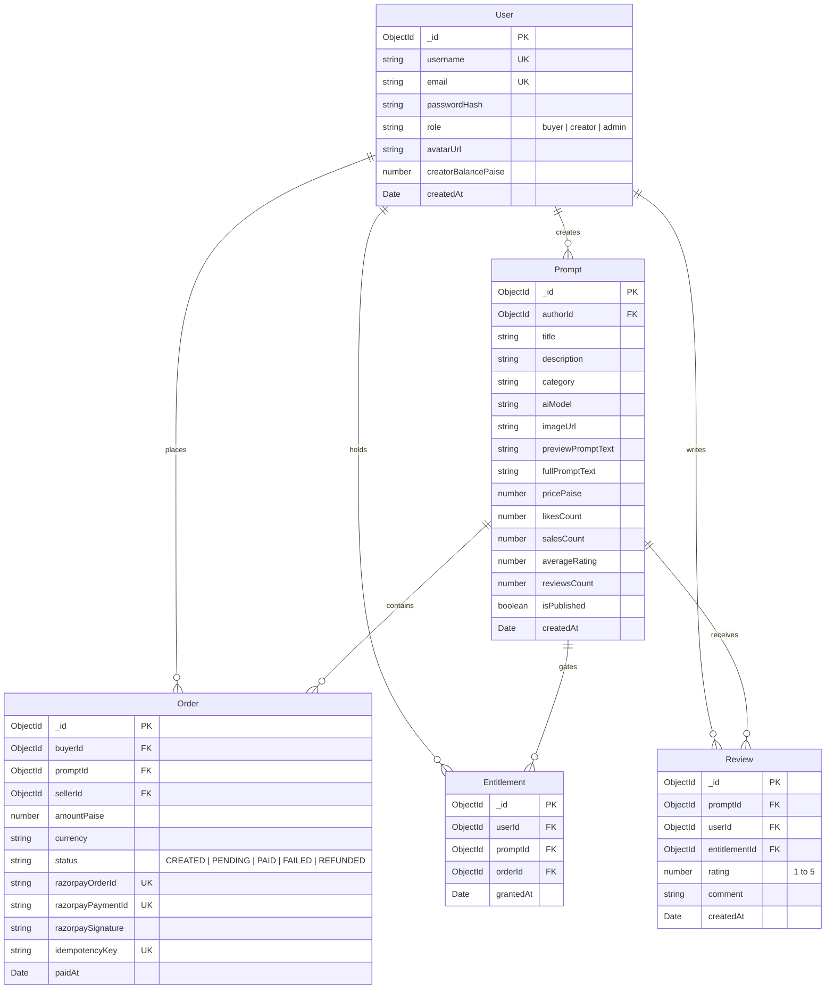

# PromptForge | AI Prompt Marketplace & Digital Goods Platform

[](https://nodejs.org)
[](https://expressjs.com)
[](https://react.dev)
[](https://mongodb.com)
[](https://redis.io)
[](https://razorpay.com)
[](https://tailwindcss.com)
[](https://docker.com)
[](LICENSE)

A production-grade, two-sided digital marketplace for generative AI image prompts (Midjourney, DALL-E 3, Stable Diffusion XL, Flux). Built with an **Express 5 modular monolith**, **React 19 SPA**, and a **MongoDB + Redis** data tier, PromptForge enables AI creators to monetize tested prompts and gives buyers instant, cryptographically verified access to prompt parameters, negative prompts, and configuration seeds.

---

## Architecture Overview



---

## Key Features & Engineering Highlights

### 1. Razorpay Payment Gateway & Cryptographic Verification
* **Dual-Channel Settlement**: Handles synchronous client-side confirmation alongside asynchronous, idempotent Razorpay webhook event processing (`payment.captured`, `payment.failed`, `order.paid`).
* **Cryptographic Tamper-Proofing**: Strict HMAC-SHA256 signature verification computed over `order_id + "|" + payment_id` against the secret key using `crypto.timingSafeEqual` to eliminate timing attack vectors.
* **ACID Transaction Fulfillment**: Uses MongoDB sessions (`startTransaction`) to atomically update order status to `PAID`, record payment IDs, increment creator balances, and grant user entitlements in a single isolated transaction.
* **Idempotency Keys**: Unique database indexes on `idempotencyKey` and `razorpayOrderId` prevent duplicate payments, double fulfillments, and race conditions during network retries.

```mermaid
sequenceDiagram
    autonumber
    actor Buyer as Buyer
    participant UI as React Client
    participant API as Express Monolith
    participant DB as MongoDB
    participant Razorpay as Razorpay API
    participant Webhook as Webhook Listener

    Buyer->>UI: Clicks "Purchase Prompt" (₹399)
    UI->>API: POST /api/v1/orders/create { promptId }
    API->>DB: Check Entitlement & Price
    API->>Razorpay: razorpay.orders.create({ amount, currency: "INR", receipt })
    Razorpay-->>API: Returns razorpay_order_id
    API->>DB: Save Order (status: PENDING, idempotencyKey)
    API-->>UI: Return { orderId, razorpayOrderId, amount, keyId }
    UI->>Razorpay: Open Razorpay Checkout Modal
    Buyer->>Razorpay: Authenticates UPI / Card Payment
    Razorpay-->>UI: Return { razorpay_payment_id, razorpay_signature }

    alt Fast Path: Client Signature Verification
        UI->>API: POST /api/v1/orders/verify
        API->>API: HMAC-SHA256(order_id + "|" + payment_id, secret)
        API->>DB: Atomic Transaction: status=PAID, grant Entitlement
        API-->>UI: 200 OK { success: true, fullPrompt: "..." }
    else Resilient Fallback: Webhook Fulfillment
        Razorpay->>Webhook: POST /api/v1/payments/webhook [payment.captured]
        Webhook->>Webhook: Verify x-razorpay-signature
        Webhook->>DB: Check status; if PENDING -> update to PAID & grant Entitlement
        Webhook-->>Razorpay: 200 OK
    end
```

---

### 2. Zero-Knowledge Digital Entitlement Engine
* **Database-Level Content Redaction**: To prevent client-side scraping, high-value prompt parameters (`fullPromptText`, model seeds, negative prompts) are excluded at the database projection layer (`.select('-fullPromptText')`) across all public catalog queries.
* **Entitlement Access Control**: Protected prompt parameters are unlocked only when the requester satisfies at least one condition:
  1. The prompt is published as Free (`pricePaise === 0`).
  2. The authenticated user is the original creator (`authorId === req.user.id`).
  3. The authenticated user owns an active `Entitlement` linked to a verified `PAID` order.
* **Teaser / Masked Mode**: Unverified visitors receive a preview teaser string (`"Cinematic portrait of [LOCKED - Purchase to unlock complete prompt, model parameters, and seed]"`) and watermarked image assets.

---

### 3. High-Performance Search, Multi-Facet Filtering & Cursor Pagination
* **Database Compound Indexing**: Eliminates full collection scans through compound indexes:
  `{ category: 1, aiModel: 1, pricePaise: 1, createdAt: -1 }`
* **Full-Text Keyword Search**: MongoDB `$text` index across `title`, `description`, and `tags` supporting stemmed lexical matching.
* **Server-Side Pagination**: Replaces memory-heavy client slicing with database-level `{ skip, limit }` pagination and cursor pointers, returning total counts, total pages, and cache metadata.
* **Multi-Facet Queries**: Real-time filtering across:
  * **Categories**: Digital Art, Photography, Concept Art, 3D Render, Anime, Vector Illustration.
  * **AI Engines**: Midjourney v6, DALL-E 3, Stable Diffusion XL, Flux.1, Ideogram.
  * **Pricing Tiers**: All, Free, Paid (min/max price ranges).
  * **Sorting**: Trending (likes), Newest, Top Selling, Price: Low to High, Price: High to Low.

---

### 4. Creator Revenue Dashboard & Verified Buyer Reviews
* **Closed-Loop Verified Reviews**: Only users with verified `Entitlement` records for a prompt can submit 1–5 star ratings and reviews, preventing review spam and fake social proof.
* **Real-Time Aggregate Ratings**: Automated Mongoose middleware hooks recalculate `averageRating` and `reviewsCount` on the prompt document using MongoDB aggregation pipelines upon review submission.
* **Creator Analytics Engine**: Dedicated seller portal delivering:
  * Lifetime gross revenue, platform commission deductions, and net withdrawable balance.
  * Prompt conversion metrics: views, likes, purchases, and conversion rate per prompt.
  * Sales volume breakdowns by AI model and category over time.

---

### 5. Multi-Tier Caching & Distributed Security
* **Redis Cache-Aside Pattern**: High-frequency queries (such as `/prompts/trending` and top search queries) are served directly from Redis with automatic TTL expiration (3 to 10 minutes) and automated invalidation when creators publish or update listings.
* **Distributed Rate Limiting**: Built on Redis to prevent DDoS, credential stuffing, and payment endpoint exhaustion:
  * Strict limits on `/api/v1/auth/login` (5 attempts per 15 min per IP).
  * Payment generation limit on `/api/v1/orders/create` (10 per minute per user).
  * Catalog limit (120 requests per minute per IP).
* **Security Hardening**:
  * HTTP security headers via **Helmet** (CSP, HSTS, frameguard).
  * Environment-adaptive **HTTP-Only, SameSite Cookies** (Secure in production, Lax in local dev).
  * Input schema validation using **Zod** covering all incoming body payloads, query parameters, and route IDs.

---

## Database Architecture



---

## Technology Stack

| Domain | Technology | Version | Purpose |
| :--- | :--- | :--- | :--- |
| **Frontend Framework** | React | `v19.1` | Concurrent component rendering & state management |
| **Build Tool** | Vite | `v7.1` | Native ESM bundling & rapid development server |
| **Styling & Icons** | Tailwind CSS / Lucide | `v4.1` / `v0.546` | Utility-first responsive design & accessible UI icons |
| **Client Routing** | React Router | `v7.9` | Client-side routing with animated state transitions |
| **Notifications** | React Hot Toast | `v2.6` | Lightweight contextual toast notifications |
| **Backend Runtime** | Node.js (ESM) | `v20+` | High-throughput asynchronous runtime |
| **Web Framework** | Express | `v5.1` | Modular HTTP API router & middleware chain |
| **Primary Database** | MongoDB | `v8.0` | Flexible JSON document store with aggregation pipelines |
| **Database Driver** | Mongoose | `v8.19` | Schema definitions, validation, and relational population |
| **Cache & Limiting** | Redis / ioredis | `v7.0` / `v5.3` | Cache-aside query acceleration & distributed rate limiting |
| **Payment Gateway** | Razorpay SDK | `v2.9` | Payment orders, webhook verification, and UPI/card flow |
| **Authentication** | JWT / Bcrypt | `v9.0` / `v6.0` | Stateless session management via HTTP-only cookies |
| **Input Validation** | Zod | `v3.23` | Runtime schema validation for request payloads |
| **Security** | Helmet / CORS | `v8.0` / `v2.8` | HTTP header protection and origin whitelisting |
| **Containerization** | Docker / Docker Compose | Latest | Reproducible multi-service deployment |

---

## REST API Specification

### Authentication (`/api/v1/auth`)
| Method | Endpoint | Description | Auth Required |
| :--- | :--- | :--- | :--- |
| `POST` | `/api/v1/auth/signup` | Registers new user; returns sanitized profile and sets HTTP-only cookie. | No |
| `POST` | `/api/v1/auth/login` | Authenticates email/password; sets JWT cookie. | No |
| `POST` | `/api/v1/auth/logout` | Clears authentication cookie and session state. | Yes |
| `GET` | `/api/v1/auth/me` | Retrieves authenticated user profile, role, and purchased prompt IDs. | Yes |

### Prompt Catalog & Search (`/api/v1/prompts`)
| Method | Endpoint | Description | Auth Required |
| :--- | :--- | :--- | :--- |
| `GET` | `/api/v1/prompts` | Paginated search with filtering (`q`, `category`, `aiModel`, `minPrice`, `maxPrice`, `sort`, `page`, `limit`). Content masked. | No |
| `GET` | `/api/v1/prompts/trending` | Returns top trending prompts from Redis cache. | No |
| `GET` | `/api/v1/prompts/:id` | Returns single prompt. Delivers `fullPromptText` only if user holds entitlement or is creator. | Optional |
| `POST` | `/api/v1/prompts` | Uploads image and creates prompt listing (title, description, price, model, full prompt). | Yes |
| `PUT` | `/api/v1/prompts/:id` | Updates prompt metadata and pricing (creator only). | Yes |
| `POST` | `/api/v1/prompts/:id/like` | Toggles like state atomically using user JWT. | Yes |

### Orders & Payments (`/api/v1/orders`)
| Method | Endpoint | Description | Auth Required |
| :--- | :--- | :--- | :--- |
| `POST` | `/api/v1/orders/create` | Validates entitlement status and generates Razorpay order token. | Yes |
| `POST` | `/api/v1/orders/verify` | Validates HMAC-SHA256 signature, transitions order to `PAID`, grants entitlement. | Yes |
| `GET` | `/api/v1/orders/my-orders` | Returns user's complete purchase history and transaction status. | Yes |
| `POST` | `/api/v1/payments/webhook` | Processes asynchronous Razorpay webhook events using raw body verification. | Webhook Signature |

### Creator Dashboard & Reviews (`/api/v1/creator`, `/api/v1/reviews`)
| Method | Endpoint | Description | Auth Required |
| :--- | :--- | :--- | :--- |
| `GET` | `/api/v1/creator/analytics` | Aggregates gross revenue, platform fees, conversion rates, and sales counts. | Yes (Creator) |
| `POST` | `/api/v1/prompts/:id/reviews` | Submits rating (1–5) and review; verifies prior purchase via entitlement. | Yes |
| `GET` | `/api/v1/prompts/:id/reviews` | Returns paginated verified reviews for a prompt. | No |

---

## Getting Started

### Prerequisites
* **Node.js** v20.x or higher
* **npm** v10.x or higher
* **MongoDB** (Local instance or MongoDB Atlas cluster)
* **Redis** (Local instance or Upstash Redis)
* **Razorpay Test Account** ([Dashboard](https://dashboard.razorpay.com))

---

### Option A: Docker Compose (Recommended)

Boot the entire ecosystem (Client, Express API, MongoDB, Redis) with a single command:

```bash
# 1. Clone repository
git clone https://github.com/Shardul-Pathak/test-SMP.git
cd test-SMP

# 2. Configure environment variables
cp server/.env.example server/.env
cp client/.env.example client/.env

# 3. Spin up multi-container environment
docker compose up --build
```

* **Frontend**: `http://localhost:5173`
* **Backend API**: `http://localhost:3000`
* **Redis**: `localhost:6379`
* **MongoDB**: `localhost:27017`

---

### Option B: Manual Local Setup

#### 1. Backend Server Setup
```bash
cd server
npm install

# Create environment configuration
cat <<EOF > .env
PORT=3000
NODE_ENV=development
DB_URL=mongodb://localhost:27017/promptforge
JWT_Secret_Key=your_super_secret_jwt_key_at_least_32_characters
REDIS_URL=redis://localhost:6379
RAZORPAY_KEY_ID=rzp_test_yourKeyIdHere
RAZORPAY_KEY_SECRET=yourRazorpayKeySecretHere
RAZORPAY_WEBHOOK_SECRET=yourWebhookSecretHere
ALLOWED_ORIGINS=http://localhost:5173
CLOUDINARY_CLOUD_NAME=yourCloudNameHere
CLOUDINARY_API_KEY=yourCloudinaryApiKeyHere
CLOUDINARY_API_SECRET=yourCloudinaryApiSecretHere
EOF

# Start development server
npm run dev
```

#### 2. Frontend Client Setup
```bash
cd ../client
npm install

# Create environment configuration
cat <<EOF > .env
VITE_API_URL=http://localhost:3000/api/v1
VITE_RAZORPAY_KEY_ID=rzp_test_yourKeyIdHere
EOF

# Start Vite development server
npm run dev
```

Navigate to `http://localhost:5173` in your browser.

---

## Environment Variables Reference

### Backend (`server/.env`)
| Variable | Description | Example |
| :--- | :--- | :--- |
| `PORT` | Express listening port | `3000` |
| `NODE_ENV` | Runtime environment (`development` / `production`) | `development` |
| `DB_URL` | MongoDB connection URI with replica set support | `mongodb://localhost:27017/promptforge` |
| `JWT_Secret_Key` | Secret string for HMAC signing of session tokens | `random_hex_32_chars_min` |
| `REDIS_URL` | Redis connection URI | `redis://localhost:6379` |
| `RAZORPAY_KEY_ID` | Razorpay public key ID | `rzp_test_XXXXXXXXXXXXXX` |
| `RAZORPAY_KEY_SECRET` | Razorpay private secret key | `XXXXXXXXXXXXXXXXXXXXXXXX` |
| `RAZORPAY_WEBHOOK_SECRET` | Secret configured in Razorpay Webhooks dashboard | `whsec_XXXXXXXXXXXXXXXXXXXX` |
| `ALLOWED_ORIGINS` | Comma-separated list of CORS whitelisted domains | `http://localhost:5173,https://promptforge.app` |
| `CLOUDINARY_CLOUD_NAME` | Cloudinary account cloud name | `promptforge_cloud` |
| `CLOUDINARY_API_KEY` | Cloudinary access API key | `123456789012345` |
| `CLOUDINARY_API_SECRET` | Cloudinary private secret key | `XXXXXXXXXXXXXXXXXXXXXXXXXXXX` |

### Frontend (`client/.env`)
| Variable | Description | Example |
| :--- | :--- | :--- |
| `VITE_API_URL` | Base URL of the backend API v1 | `http://localhost:3000/api/v1` |
| `VITE_RAZORPAY_KEY_ID` | Razorpay public key used by the Checkout SDK | `rzp_test_XXXXXXXXXXXXXX` |

---

## Razorpay Webhook Configuration & Local Testing

### 1. Dashboard Settings
Navigate to **Razorpay Dashboard** (in **Test Mode**) → **Account & Settings** → **Webhooks** → **+ Add New Webhook**:
* **Webhook URL**:
  * **Production**: `https://<your-api-domain>/api/v1/payments/webhook`
  * **Local Development**: `https://<your-ngrok-subdomain>.ngrok-free.app/api/v1/payments/webhook`
* **Secret**: The exact secret string matching `RAZORPAY_WEBHOOK_SECRET` in your `server/.env`.
* **Alert Email**: Your developer email address for delivery notifications.
* **Active Events**: Select only:
  1. `payment.captured` *(Fired on successful settlement; unlocks prompt and credits seller)*
  2. `payment.failed` *(Fired on declined payments; marks order as FAILED)*
  3. `order.paid` *(Secondary idempotent settlement guarantee)*

### 2. Testing Webhooks Locally with ngrok
Because Razorpay's servers cannot reach `http://localhost:3000`, use a tunnel:
```bash
# 1. Start tunnel to your local backend port
npx ngrok http 3000

# 2. Copy the generated HTTPS forwarding URL (e.g., https://abcd-1234.ngrok-free.app)
# 3. In Razorpay Webhook settings, set Webhook URL to:
#    https://abcd-1234.ngrok-free.app/api/v1/payments/webhook
# 4. In Razorpay Dashboard, click "Send Test Webhook" to verify 200 OK delivery.
```

---

## Verification & Testing Suite

PromptForge includes automated test suites covering unit logic, cryptographic signatures, and end-to-end integration workflows:

```bash
# Run unit and integration tests
cd server
npm run test

# Run tests with coverage report
npm run test:coverage
```

### Core Test Coverage Matrix
* **Cryptographic Verification**: Tests valid, corrupted, and replay attacks on Razorpay HMAC-SHA256 signatures.
* **Content Masking**: Verifies that unauthenticated requests to `/api/v1/prompts` never expose `fullPromptText`.
* **Idempotent Webhooks**: Validates that sending duplicate `payment.captured` webhook payloads executes exactly once and returns HTTP 200 without creating duplicate entitlements.
* **Transaction Rollback**: Simulates database connection interruption mid-payment verification to ensure the transaction aborts cleanly without partial state persistence.

---

## Technical Trade-offs & Engineering Decisions

1. **Modular Monolith over Microservices**:
   * *Rationale*: Separating this system into individual auth, catalog, and payment microservices would add distributed transaction complexity (Sagas, two-phase commits) and network latency. A clean, domain-separated modular monolith gives superior developer velocity, unified transactions, and simple deployment while maintaining clear internal boundaries.
2. **Redis Cache-Aside over Full Database Replication**:
   * *Rationale*: Applying cache-aside with a 180–300 second TTL on search and trending endpoints absorbs 90%+ of read traffic without risking stale financial data or inventory states.
3. **Raw Body Webhook Handling**:
   * *Rationale*: Razorpay requires exact byte-for-byte HMAC verification of the incoming webhook body. The webhook router registers `express.raw({ type: 'application/json' })` strictly for webhook endpoints before standard `express.json()` body parsing occurs.
4. **Entitlements Collection as an Ownership Ledger**:
   * *Rationale*: Instead of storing purchased prompt IDs in an unbounded array on the user document (which risks hitting MongoDB's 16MB document limit), entitlements are stored as individual relational documents with a unique compound index (`userId + promptId`), facilitating $O(1)$ indexed lookup and clean audit logging.

---

## License

This project is licensed under the MIT License — see the [LICENSE](LICENSE) file for details.
